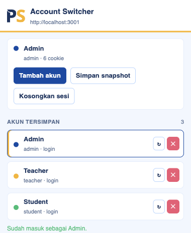
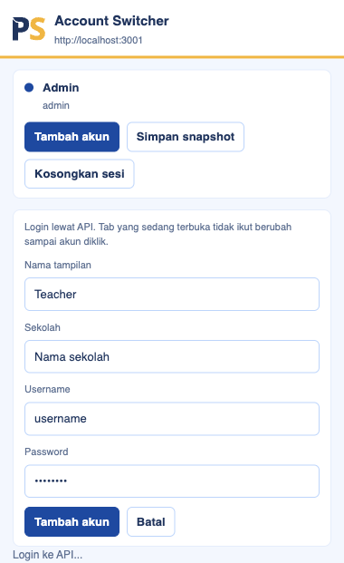

# Portal Sekolah Account Switcher

Chrome extension untuk ganti akun testing Portal Sekolah tanpa logout/login di web. Login dipanggil dari extension (`POST /v2/auth/login/`), cookie baru dipasang hanya saat akun diklik, dan refresh token dijalankan otomatis tiap 10 menit.

## Kenapa tidak lewat halaman login

Kalau cookie masih ada, `http://localhost:3000/login` langsung redirect ke dashboard. Akun kedua tidak bisa dimasukkan dari form web. Extension login ke API sendiri, jadi tab yang sedang terbuka tidak perlu dilogout dulu.

## Install

1. Clone repo ini
2. Buka Chrome, ketik `chrome://extensions`
3. Nyalakan **Developer mode** (pojok kanan atas)
4. Klik **Load unpacked**
5. Pilih folder hasil clone ini
6. Pin ikon **PS** di toolbar Chrome

Kalau file extension berubah, tekan **Reload** di kartu extension itu.

## Akun testing

Pakai akun testing tim (admin, guru, siswa). Username dan password **tidak disimpan di repo ini**. Tanyakan ke tim kalau belum punya akses.

Saat menambah akun, ketik nama sekolah (min. 3 huruf) lalu pilih dari daftar.

## Pakai, step by step

### 1. Buka aplikasi

Jalankan login app di `:3000` dan app yang ditest di `:3001`. Tab Chrome boleh sudah login sebagai salah satu role.

### 2. Tambah akun (tidak mengganti tab)

Klik ikon extension, lalu **Tambah akun**. Isi nama tampilan, sekolah, username, dan password.

Klik **Tambah akun**. Tab yang sedang terbuka **tidak berubah**.

Ulangi untuk role lain yang mau disimpan.

### 3. Ganti akun

Klik nama akun di daftar, misalnya **Teacher**. Extension akan:

1. Login atau refresh token akun itu
2. Ganti cookie `psauthtoken` / `psrefreshtoken` / `userRole`
3. Reload tab

Hasilnya tab langsung jadi sesi guru, tanpa isi form login.

### 4. Hapus akun dari daftar

Klik **✕**, lalu klik **Hapus**. (Chrome menutup popup kalau pakai dialog `confirm`, jadi konfirmasinya di dalam popup.)

### 5. Kosongkan sesi tab

Kalau ingin web benar-benar logout, klik **Kosongkan sesi** dua kali. Cookie login di tab itu dihapus, lalu tab reload.

## Tombol lain

| Tombol | Fungsi |
| --- | --- |
| Tambah akun | Login ke API, simpan kredensial. Tab tidak diganti. |
| Simpan snapshot | Simpan cookie tab yang sedang login, tanpa password. |
| ↻ | Refresh token atau login ulang untuk akun itu. |
| ✕ | Hapus akun dari daftar. |

## Refresh token otomatis

Service worker memanggil `POST /v2/auth/refresh/` tiap 10 menit untuk semua akun tersimpan. Saat akun diklik:

1. Pakai access token yang masih hidup, atau
2. Refresh, atau
3. Login ulang pakai password kalau refresh sudah mati

API default: `https://backend-v2.portal-sekolah.com/api`

Host yang didukung: `localhost`, `portal-sekolah.com`

## Yang perlu diingat

- Password dan token tersimpan di `chrome.storage.local` browser pemakai. Jangan install di komputer orang luar.
- Cookie `localhost` berlaku di semua port (`:3000` dan `:3001`). `localStorage` tidak, itu per origin.
- Access token Portal Sekolah umurnya pendek. Refresh token lebih lama. Kalau dua-duanya mati, klik akun itu lagi, extension login ulang sendiri.
